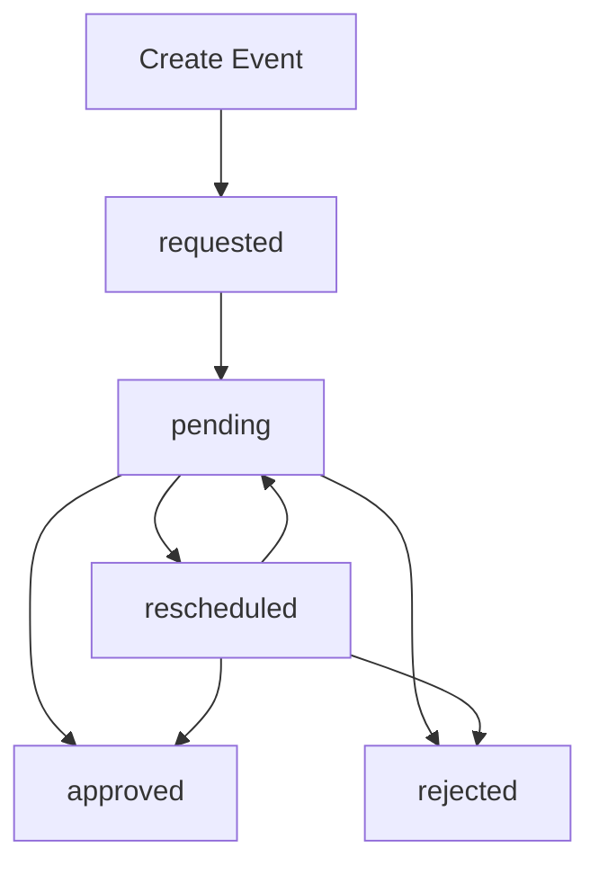
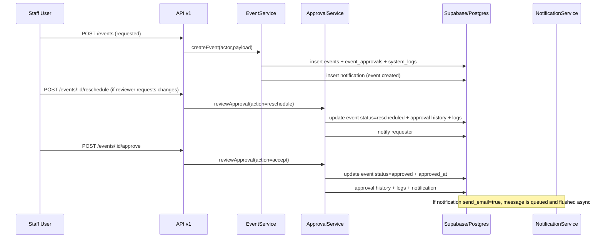

# Backend Architecture & Guide

## 1. Overview

### 1.1 High-level Description of the System
UNITE Backend Enterprise is a multi-tenant backend for blood bank operations, built around these primary domains:

- Authentication and session control
- Organization and staff onboarding
- Event lifecycle management (request, review, approval, reschedule, cancellation)
- Participant and staff assignment to events
- Notification dispatch (in-app and email)
- Real-time one-to-one chat with media support
- Organization and user-level settings
- Auditing via system logs

The architecture is API-first and service-oriented:

- Routes define HTTP surface area and middleware composition.
- Controllers validate/normalize HTTP inputs and shape responses.
- Services contain business rules and data orchestration.
- Supabase provides Auth, Postgres, Realtime, and Storage.
- SQL schemas and RLS policies enforce tenant boundaries and row-level permissions.

### 1.2 Technology Stack

- Runtime/API:
  - Node.js
  - Express
  - TypeScript (most API modules), with JS bootstrap entrypoints
- Data/Auth/Infra:
  - Supabase Postgres
  - Supabase Auth (email/password + OTP verification support)
  - Supabase Realtime (event and chat subscriptions)
  - Supabase Storage (chat file uploads)
- Validation/Safety:
  - Zod for request and payload validation
  - express-rate-limit for endpoint-level throttling
  - Helmet + CORS in API bootstrap

### 1.3 Multi-tenancy Design
Tenant isolation is based on org-scoping at every layer:

- Every business table includes org_id (users, events, participants, staff assignments, notifications, settings, chat, logs, queue tables).
- Services always scope reads/writes by actor.org_id and target resource org_id.
- RLS policies enforce org boundaries in SQL using helper functions such as:
  - current_org_id()
  - current_user_org_id()
  - current_user_profile_id()
  - current_user_role_type()
  - current_user_has_permission(permission)
- Public visibility is selective (for example, events with is_public = true).

This is a defense-in-depth model:

1. API authorization checks in middleware/controllers/services
2. Database-level tenant and permission enforcement via RLS
3. Schema constraints and triggers for workflow integrity

---

## 2. Authentication & Authorization

### 2.1 How Login Works
Login endpoint: POST /api/v1/auth/login

Login flow:

1. Validate email/password payload.
2. Authenticate using Supabase Auth signInWithPassword.
3. Require verified email (email_confirmed_at must exist).
4. Load user profile from public.users.
5. Check is_active:
   - false => pending/inactive behavior (login denied)
6. Load organization (if user has org_id) and require org is active.
7. Return:
   - user profile context
   - org context
   - access and refresh tokens
   - redirect hint based on role

Example request:

```json
{
  "email": "admin@bloodbank.org",
  "password": "StrongPass123"
}
```

Example success response:

```json
{
  "success": true,
  "data": {
    "user": {
      "id": "...",
      "email": "admin@bloodbank.org",
      "full_name": "Admin User",
      "org_id": "...",
      "role": {
        "type": "super_admin",
        "permissions": ["*"]
      },
      "is_active": true,
      "email_verified": true
    },
    "organization": {
      "id": "...",
      "name": "UNITE Blood Bank",
      "is_active": true
    },
    "accessToken": "...",
    "refreshToken": "...",
    "redirectTo": "/admin/dashboard"
  }
}
```

### 2.2 How Signup Works (Admin vs Staff)
Signup endpoint: POST /api/v1/users/signup

Routing behavior:

- If role=admin or organization object is present, request is treated as Admin Signup.
- Otherwise it is treated as Staff Signup.

#### Admin Signup
Purpose: create a new tenant plus its first admin user.

Flow:

1. Validate base signup fields.
2. Require organization.name and organization.code.
3. Create organization record.
4. Create Supabase Auth user for admin.
5. Create users profile with:
   - role.type = super_admin
   - permissions = ["*"]
   - is_active = true
6. Enforce one active super_admin per org.
7. Send verification code email.

Admin signup response includes:

- organization data
- created user profile
- auth_user_id for OTP verification

#### Staff Signup
Purpose: self-register into an existing org via org code.

Flow:

1. Validate signup fields.
2. Resolve org via org_code (or organizationCode/invitation_code aliases).
3. Create Supabase Auth user.
4. Create users profile with:
   - role.type = staff
   - permissions = []
   - is_active = false (pending approval)
5. Send verification code email.

Staff signup response includes user + auth_user_id. Access remains blocked until staff approval and active status are satisfied.

### 2.3 Email Verification / OTP Flow
Endpoints:

- POST /api/v1/auth/verify-otp
- POST /api/v1/auth/resend-otp

OTP behavior:

- 6-digit OTP generated server-side.
- Saved in email_verification_codes with:
  - auth_user_id
  - email
  - expires_at (10 minutes)
  - attempts and max_attempts
- verify-otp:
  - validates format
  - checks non-expired and not used
  - enforces max attempts
  - marks code as used
  - calls Supabase admin API to confirm email
- resend-otp:
  - allows resend with anti-spam limit (max 3 unused sends/hour per email)

### 2.4 Role System
Role data is stored in users.role JSONB:

```json
{
  "type": "super_admin",
  "permissions": ["*"]
}
```

Observed role types across modules:

- super_admin
- org_admin (declared in auth types)
- admin (used in event/chat/settings checks)
- coordinator
- staff
- donor
- stakeholder
- volunteer

Permission model:

- Flat string array permissions
- "*" grants full permission
- Typical checks include:
  - create_events
  - manage_events
  - approve_events
  - manage_users
  - approve_staff
  - manage_org_settings
  - manage_notifications
  - assign_event_staff

### 2.5 What Each Role Can and Cannot Access
Practical behavior from services and RLS:

- super_admin:
  - Full org authority; bypasses most permission checks
  - Can approve staff and manage org settings
  - Can manage events and users
- admin/coordinator (service-level semantics):
  - Can approve/review events if role or permission allows
  - Often can manage staff/event assignments
- staff:
  - Can create/request events only if permitted
  - Usually limited to own profile/settings and participant-level actions
- donor:
  - Limited participation scope, not manager workflows

Important note:

- Exact capabilities are determined by both role.type and permissions array, plus org and geo constraints.

### 2.6 is_active / Pending Approval System
is_active is a central gate:

- Middleware blocks inactive users from protected endpoints (403 INACTIVE_USER).
- Staff self-signup defaults to is_active=false.
- Staff approval endpoint can transition pending user to active.
- Login denies inactive users as pending approval or inactive.

---

## 3. Organization & User Management

### 3.1 How Organizations Are Created
Organizations are created during admin signup via OrganizationService:

- code is normalized to uppercase
- uniqueness enforced (case-insensitive uniqueness index)
- contact info and metadata supported
- is_active defaults true

Schema guarantees:

- code format: ^[A-Z0-9_-]{3,32}$
- lower(code) unique index

### 3.2 How Staff Join an Organization
Staff self-signup uses org code lookup:

- org must exist and be active
- auth account created
- profile created in users with org_id and staff role
- profile is inactive until approval

### 3.3 Organization Settings
Organization settings are 1:1 per org and include scheduling constraints:

- max_blood_bags_per_day
- max_events_per_day
- event_request_advance_days
- prevent_double_booking_same_day
- allow_weekend_events
- banned_days_of_week
- banned_specific_dates
- config JSON for extensible flags (for example chat policy toggles)

Read:

- Any active user in org can read org settings via service/controller checks and RLS.

Write:

- Restricted to super_admin/admin-like users (API + RLS combination).

### 3.4 User Settings (Notifications)
User settings are personal preferences:

- enable_email_notifications
- enable_in_app_notifications
- enable_all_notifications
- preferences JSON (timezone, language, digest settings, etc.)

Endpoints:

- GET /api/v1/settings/user
- PATCH /api/v1/settings/user
- PATCH /api/v1/users/settings

Both routes update user settings through UserSettingsService patterns.

### 3.5 Staff Approval Process
Endpoint: POST /api/v1/users/approve-staff

Payload pattern:

```json
{
  "userId": "uuid",
  "status": "approve",
  "reason": "optional"
}
```

Flow:

- Approver must be active and authorized (super_admin, wildcard, or approve_staff permission).
- If status=approve:
  - activate target user (is_active=true)
  - emit notification to approved user
- If status=reject:
  - keep/force inactive state

---

## 4. Event Management (Detailed Flow)

### 4.1 How Events Are Created (Status starts as requested)
Endpoint: POST /api/v1/events

Create checks:

1. Actor must be active and in org.
2. Actor must have create permission or coordinator+ role.
3. Payload must satisfy event schema:
   - type in blood_drive|training|advocacy
   - valid date/time window
   - extra_data shape per type
4. Organization settings validation:
   - advance-day minimum
   - banned weekdays/specific dates
   - weekend policy
   - max events/day
   - double-booking overlap checks when enabled

Status assignment:

- default requested
- if actor is super_admin or has auto_approve_events, event can start approved

Side effects:

- insert event_approvals history row
- write system_logs (event_created)
- insert notifications row about creation

### 4.2 Full Approval Workflow (request -> reviewer -> accept/reject/reschedule)
Core approval endpoint set:

> [!NOTE]
> **Deprecated Workflow:** The endpoints below (`/approve`, `/reject`, `/reschedule`) are officially deprecated and return `EVENT_WORKFLOW_DEPRECATED`. The active event lifecycle uses `POST /events/:id/complete-details` and `POST /events/:id/publish` via `EventOperationsService`.

- POST /api/v1/events/:id/approve (Deprecated)
- POST /api/v1/events/:id/reject (Deprecated)
- POST /api/v1/events/:id/reschedule (Deprecated)
- POST /api/v1/events/:id/complete-details (Active)
- POST /api/v1/events/:id/publish (Active)

Approval service behavior:

1. Load event and ensure same org.
2. Validate actor can review:
   - role at least coordinator OR approve_events permission
   - geographic match with event geo scope
3. Validate transition is legal.
4. Patch event status:
   - accept => approved
   - reject => rejected
   - reschedule => rescheduled (+ proposed schedule patch)
5. Insert event_approvals audit row.
6. Notify event requester.
7. Record system log.

### 4.3 Reschedule Loop Explanation
Reschedule generates iterative review cycles:

- Status becomes rescheduled.
- Proposed event_date/start_time/end_time are written.
- Requester or authorized staff can request approval again (pending).
- Reviewer may accept/reject/reschedule again.

Mermaid flow:



### 4.4 Who Can Review/Approve Events (Role + Geographic Area Rules)
Reviewer eligibility combines role/permission and geo logic:

- Same org required.
- Must be coordinator/admin/super_admin or have approve_events.
- Geo match applies using province/city/barangay/districts overlap checks.

Reviewer discovery (candidate listing) can include super_admin override behavior, while review execution also enforces canReview logic.

### 4.5 What Happens After an Event Is Approved (Published)
When approved:

- status=approved
- approved_at timestamp set by trigger
- event becomes eligible for public listing when is_public=true
- participant applications can proceed for approved/pending/rescheduled states

### 4.6 Canceling or Rescheduling a Published Event
Published event operations are supported in EventService:

- cancelPublishedEvent: approved -> rejected (action type event_cancelled)
- reschedulePublishedEvent: approved -> rescheduled with new schedule

Current routed endpoint:

- POST /api/v1/events/:id/cancel (uses cancelPublishedEvent)

Result:

- inserts approval history record
- writes system log
- notifies requester

### 4.7 Who Can See Which Events (Visibility Rules)
Visibility combines org membership, role/permission, geo match, and public flag:

- Same org users can see org events based on permission logic.
- Non-org users can only see public events.
- Geo mismatch may hide events for lower-role users.
- Dedicated public-only listing exists at service level (approved + is_public), though current v1 routes primarily use authenticated event listing.

---

## 5. Notifications System

### 5.1 In-app Notifications vs Email Notifications
In-app:

- Stored in notifications table
- Supports direct (user_id set) and broadcast (user_id null)
- Read state:
  - direct via notifications.is_read
  - broadcast via notification_reads junction table

Email:

- Built from notification payload and templates in utilities
- Sent through Brevo service
- Subject/body based on notification type and metadata

### 5.2 How Notifications Are Triggered
Triggers happen from several services:

- Events:
  - created/status change/review actions
- User lifecycle:
  - staff approval
- Notification service helpers:
  - notifyReviewNeeded
  - notifyEventStatusChange
  - notifySignupApprovalNeeded
- Broadcast:
  - by target users and/or role types

### 5.3 Rate Limiting and Combining Similar Notifications
Two layers:

1. HTTP endpoint throttling (notifications routes):
   - read endpoints: 60 req/min default
   - write endpoint: 20 req/min default
2. Per-user per-day channel counters (in-app/email):
   - default 50/day/channel
   - overflow queue for deferred sends

Merge strategy:

- Similar unread notifications within dedupe window (default 5 minutes) are merged.
- Aggregate count is tracked in data.aggregate_count.

Queueing:

- In-memory + overflow queue for immediate operation
- Durable DB queue via notification_email_queue when NOTIFICATION_QUEUE_BACKEND=table
- retrying/sent/failed statuses with max_attempts logic

---

## 6. Chat System

### 6.1 Real-time Messaging (WebSocket / Supabase Realtime)
Chat uses:

- chats table for one-to-one threads
- messages table for message stream
- Supabase Realtime subscriptions on messages for INSERT/UPDATE/DELETE

Capabilities in services:

- subscribeToChatUpdates(chatId, userId, handlers)
- broadcastMessage over realtime channel
- read tracking via is_read + read_at

### 6.2 Who Can Chat with Whom (Geographic Area + Role Rules)
Access checks from AccessService:

- No self-chat
- Same org required
- Optional geo enforcement (config.enforce_chat_geo_match)
- Optional role hierarchy enforcement (config.enforce_chat_role_hierarchy)

RLS for chat also enforces participant and org boundaries.

Note on identity fields:

- Chat RLS policies compare participant IDs to auth.uid().
- Elsewhere, user profiles also store auth_id separately. Aligning identity mapping consistently is important for deployment correctness.

### 6.3 File Sharing (Storage Bucket)
Chat file uploads are stored in Supabase Storage:

- default bucket: chat-files (configurable)
- path pattern: chat/{chat_id}/{fileType}/{timestamp}-{filename}
- extension allowlist and max file size are env-configurable
- signed URLs supported (default max 7 days)
- untrusted external URLs are rejected for message file payloads

---

## 7. Settings

### 7.1 Organization-level Settings (event limits, banned dates, etc.)
Organization settings directly influence event creation and scheduling:

- event_request_advance_days controls minimum lead time
- max_events_per_day limits day-level event count
- prevent_double_booking_same_day blocks overlapping time windows
- allow_weekend_events toggles Saturday/Sunday scheduling
- banned_days_of_week blocks day indices
- banned_specific_dates blocks explicit dates
- config holds extensible policy flags (for example chat constraints)

### 7.2 User-level Settings
User settings drive notification behavior:

- Global switch: enable_all_notifications
- Channel switches:
  - enable_email_notifications
  - enable_in_app_notifications
- preferences JSON supports UX-level options:
  - digest frequency
  - language
  - timezone
  - push/event/org update toggles

### 7.3 How Settings Are Applied in Other Services
Cross-service usage includes:

- EventService validates event payloads against OrganizationSettings before insert.
- NotificationService checks UserSettings before in-app/email dispatch.
- Chat AccessService reads OrganizationSettings.config for geo/role chat restrictions.

---

## 8. Security & Data Isolation

### 8.1 Row Level Security (RLS) Strategy
RLS is enabled for core tenant tables and policy scopes include:

- users: same-org read, controlled write/update/delete
- organizations: own-org read, restricted writes
- events/event_staff/event_participants/event_approvals: org-scoped access with permissioned writes
- organization_settings/user_settings: own-org and own-user constraints
- notifications/notification_reads: audience-specific read and controlled write
- notification_email_queue: service-role-only queue operations
- chat/messages: participant- and org-scoped access
- system_logs: admin/super-admin read model, immutable update/delete rules

### 8.2 Multi-tenancy Enforcement (org_id everywhere)
Tenant isolation pattern:

- org_id foreign key in all tenant-scoped entities
- service-layer eq('org_id', actor.org_id) checks
- SQL constraints/trigger validation for org consistency across related rows
- helper functions to derive current user org from auth.uid()

### 8.3 API Security (protected vs public routes)
Protected by authMiddleware:

- /api/v1/events/*
- /api/v1/notifications/*
- /api/v1/settings/*
- /api/v1/users/profile
- /api/v1/users/approve-staff
- /api/v1/auth/logout

Public routes:

- /api/v1/auth/login
- /api/v1/auth/verify-otp
- /api/v1/auth/resend-otp
- /api/v1/users/signup
- /health

Additional controls:

- CORS allowlist handling
- Helmet hardening
- Route-level rate limiters for auth and notifications
- Zod validation middleware for body/query/params

---

## 9. API Structure (v1)

### 9.1 How Routes Are Organized
Root: /api/v1

Modules:

- /auth
- /users
- /events
- /notifications
- /settings

Pattern:

- routes/*.routes.ts wire middleware + validators + controllers
- controllers call service methods and map to HTTP status/shape
- services enforce business logic and orchestrate DB writes

### 9.2 General Response Format
Success format:

```json
{
  "success": true,
  "data": {}
}
```

Error format:

```json
{
  "success": false,
  "error": {
    "code": "ERROR_CODE",
    "message": "Human readable message",
    "details": {}
  }
}
```

Common status codes:

- 200 OK
- 201 Created
- 400 Validation/business rule failure
- 401 Missing/invalid auth
- 403 Forbidden or inactive user
- 404 Not found
- 429 Rate limited
- 500 Unhandled server failure

### 9.3 Route Snapshot

Auth:

- POST /api/v1/auth/login
- POST /api/v1/auth/verify-otp
- POST /api/v1/auth/resend-otp
- POST /api/v1/auth/logout

Users:

- POST /api/v1/users/signup
- GET /api/v1/users/profile
- PATCH /api/v1/users/profile
- POST /api/v1/users/approve-staff
- PATCH /api/v1/users/settings

Events:

- POST /api/v1/events
- GET /api/v1/events
- GET /api/v1/events/:id
- PATCH /api/v1/events/:id
- POST /api/v1/events/:id/approve
- POST /api/v1/events/:id/reject
- POST /api/v1/events/:id/reschedule
- POST /api/v1/events/:id/cancel
- POST /api/v1/events/:id/staff
- POST /api/v1/events/:id/apply

Notifications:

- GET /api/v1/notifications
- GET /api/v1/notifications/unread
- PATCH /api/v1/notifications/:id/read

Settings:

- GET /api/v1/settings/organization
- PATCH /api/v1/settings/organization
- GET /api/v1/settings/user
- PATCH /api/v1/settings/user

---

## 10. Key Concepts & Best Practices

### 10.1 Important Patterns Used

- Service layer first:
  - Business logic lives in services, not routes/controllers.
- Validation at boundaries:
  - Zod validators at route/controller layer and service payload boundaries.
- Consistent result contracts:
  - ServiceResult<T> with data/error pattern.
- Auditability:
  - event_approvals and system_logs capture critical transitions.
- Queue-backed notifications:
  - avoids blocking request lifecycle on email sends.
- Defense in depth:
  - middleware + service authorization + RLS.

### 10.2 Recommended Development Workflow

1. Add/adjust SQL schema and RLS first.
2. Update model types.
3. Implement service logic with ServiceResult<T> pattern.
4. Add controller mapping and route validation.
5. Add rate limits and auth middleware where needed.
6. Add notification/system log side effects for traceability.
7. Verify org_id and role/permission checks in every write path.

### 10.3 How to Extend the System for New Modules
Use this blueprint for any new bounded context (for example Donations, Inventory, Campaigns):

1. Data model
- Create table with org_id FK.
- Add constraints and indexes.
- Add triggers for updated_at and state transitions if needed.

2. RLS
- Add SELECT/INSERT/UPDATE/DELETE policies using helper functions.
- Keep service-role exceptions explicit and minimal.

3. Service
- Build module service with explicit actor context.
- Return ServiceResult<T>.
- Enforce role, permission, org, and geo scope in code.

4. API
- Add validators (Zod), controller, route module under /api/v1.
- Keep success/error response shapes consistent.

5. Cross-cutting integrations
- Add notification triggers where user-facing behavior changes.
- Add system log entries for sensitive operations.
- Add settings hooks if module behavior should be configurable.

### 10.4 Operational and Admin Notes

- Ensure environment variables for Supabase and email are correctly set, including compatibility aliases used in code.
- Keep NOTIFICATION_QUEUE_BACKEND set to table in production for durable delivery.
- Monitor notification_email_queue statuses (pending/retrying/failed) and system_logs for operational visibility.
- Validate that auth identity mapping (auth.uid, users.id, users.auth_id) is consistent across all RLS and service logic in your environment.

### 10.5 Example End-to-End Event Approval Sequence



This architecture provides a strong base for regulated, auditable, tenant-safe operations while remaining extensible for future blood bank modules.